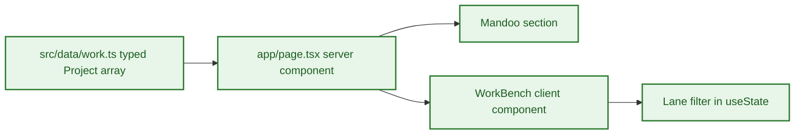
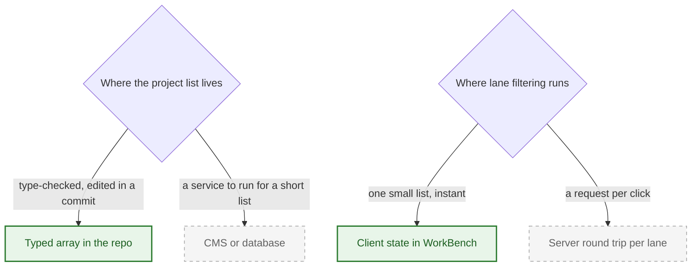

# site demo

Personal site for Aamogh. Next.js app that lists public work: agent tooling, systems experiments, shipped apps, and data projects.

## Run

```bash
bun install
bun run dev
```

Open http://localhost:3000.

## System design

How a request or a run moves through the code, then the choices behind that shape. In the decision charts, a **solid** box is the route this repo takes and a **dashed** box is the alternative it turns down; the edge label is the tradeoff.

### Request path

A Next.js app with no backend. Projects are a typed array in `src/data/work.ts`; the page renders them, and one client component, `WorkBench`, filters by lane in React state.



### Why this shape

The content changes when the work changes, so it lives in the repo as typed data and a commit is the edit. Only the filter needs the browser, so only `WorkBench` is a client component.


